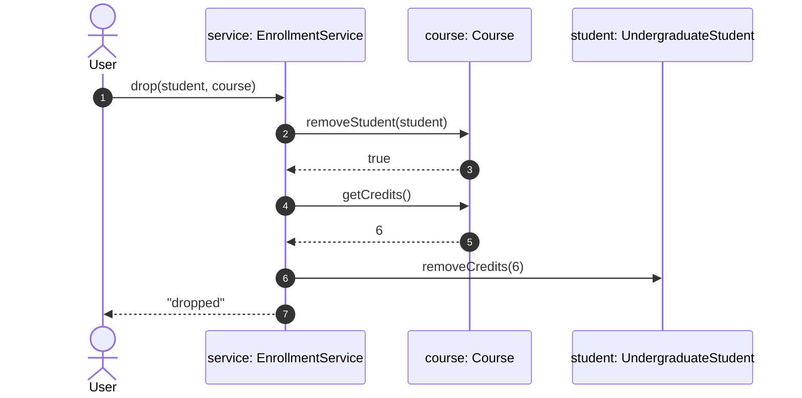
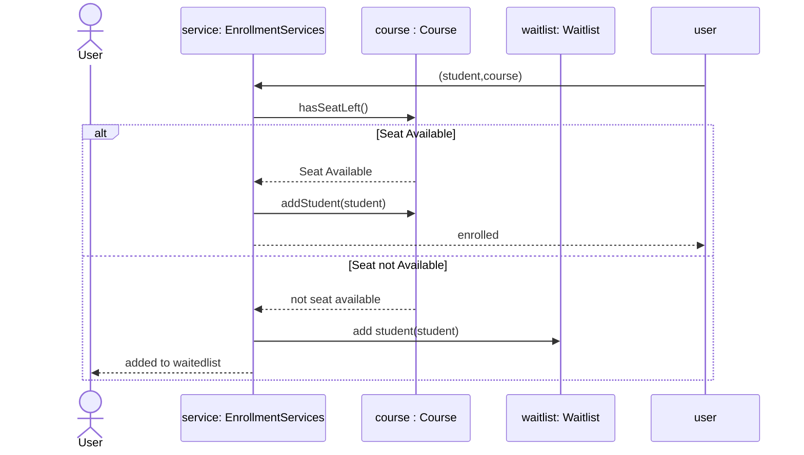
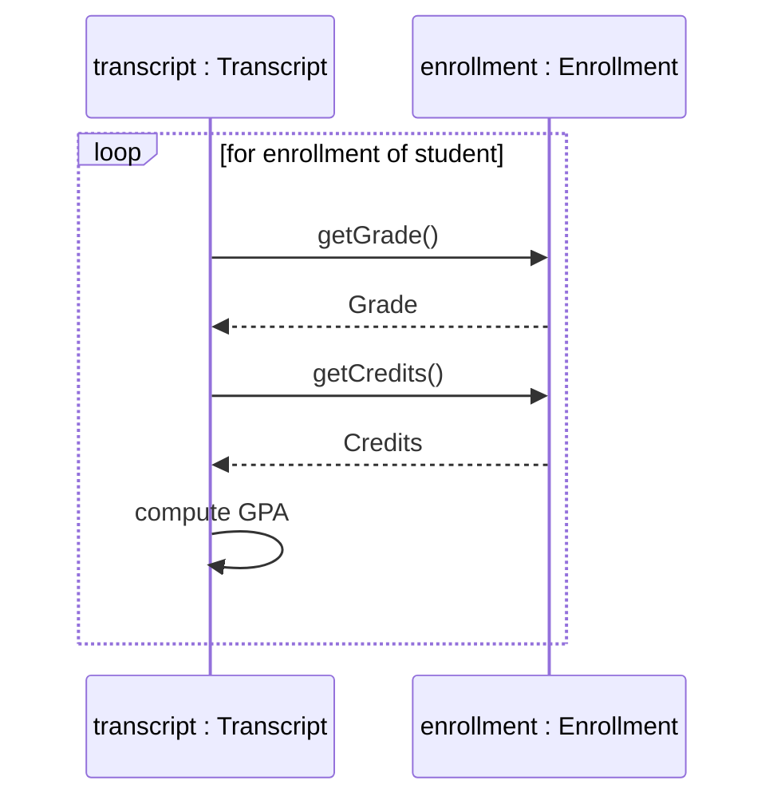
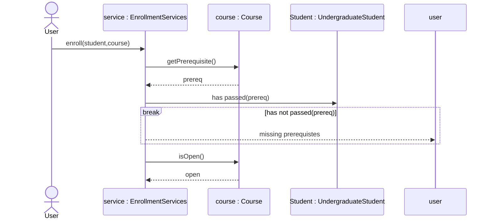
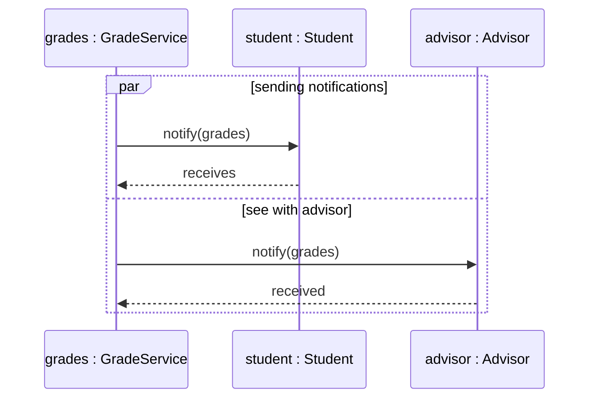
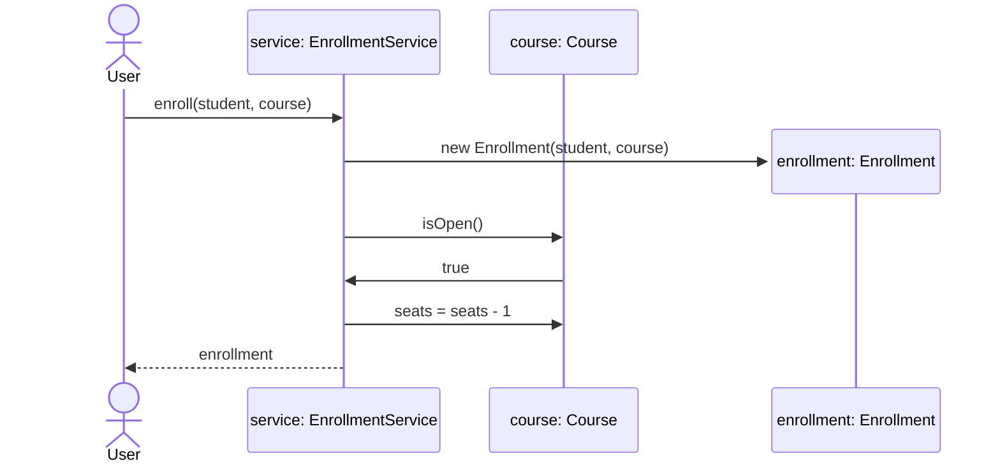
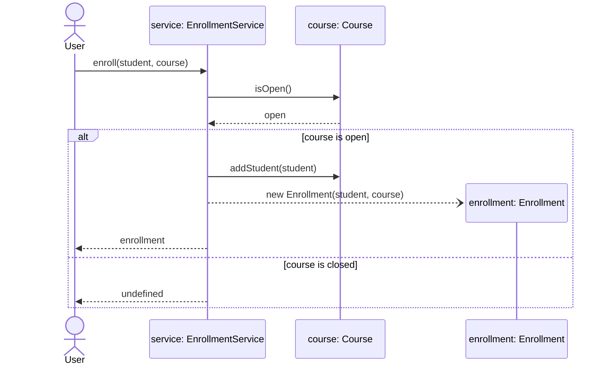

[mermaid](Lab_06_UML_Sequence_Diagrams.md)

## Exercice 1 Read a dagram
A student drops a course:


Answer with message numbers (the small numbers on the arrows):

* (a) Which messages are returns?
   responses : True; 6; "dropped" are the messages that are returned.
* (b) Which operations must `Course` have, and which must `UndergraduateStudent` have? Give the message number of each.
   responses : Course's operation : getCredits(); UndergraduateStudent : removeCredits(6)
* (c) Suppose the student was never enrolled, so message 3 returns `false`. As drawn, what happens next to the student's credits? Which fragment would you add, and which message numbers would go inside it?

## Exercise 2 — A New Object and a Message That Does Not Wait
```mermaid
sequenceDiagram
    participant service as service : EnrollmentService
    participant printer as printer : Printer
    create participant enrollment as enrollment : Enrollment
    service--)enrollment: new Enrollment(student, course)
    service->>printer: printConfirmation(enrollment)
 ```
 (a) Why does the `enrollment` box appear lower than the other two?
     response : the operation is to create so the fact that we create penrollment from service thats the explanation.
* (b) In UML, how is message 2 drawn: what kind of line, and what kind of arrowhead?
    response : I will use the word "normal" to describe how the message 2 are drawn and you have a request arrow I will say

 ## Exercises 3–7 — One Fragment Each

Each exercise uses exactly **one** fragment, of the kind in its title.

### Exercise 3 — `opt`

**Participants:** `service: EnrollmentService`, `course: Course`, `lab: LabSession`. No actor.
The service asks the course `hasLab()`. **If** the course has a lab, the service asks the lab to `reserveBench(student)`. Start with `hasLab()`.

```mermaid
sequenceDiagram
participant service as service : EnrollmentService
participant course as course: Course
participant lab as lab:LabSession
service->>course : has lab()
course-->>service : true
opt[course has lab]
service->>lab: reserveBench(student)
lab-->>service: reservationConfirmed
end
```
### Exercise 4 — `alt`

**Participants:** `User` (actor), `service: EnrollmentService`, `course: Course`, `waitlist: Waitlist`.

The user sends `enroll(student, course)` to the service. The service asks the course `hasSeatLeft()`.

* If a seat is left, it sends `addStudent(student)` to the course and answers the user `"enrolled"`.
* Otherwise, it sends `add(student)` to the waitlist and answers the user `"waitlisted"`.

### Exercise 5 — `loop`

**Participants:** `transcript: Transcript`, `enrollment: Enrollment`. No actor.

To compute a GPA, the transcript asks **each** of the student's enrollments for `getGrade()`, then `getCredits()`. The single `enrollment` lifeline stands for the enrollment of the current turn of the loop. Start with `getGrade()`.

### Exercise 6 — `break`

**Participants:** `User` (actor), `service: EnrollmentService`, `course: Course`, `student: UndergraduateStudent`.

The user sends `enroll(student, course)` to the service. The service asks the course `getPrerequisite()`, which returns `prereq`, then asks the student `hasPassed(prereq)`.

* If the student has **not** passed it, the service answers the user `"missing prerequisite"`, and the scenario stops.
* Otherwise, the service asks the course `isOpen()`. End the diagram with that message and its return.


## Exercise 7 — `par`

**Participants:** `grades: GradeService`, `student: Student`, `advisor: Advisor`. No actor.

When final grades are posted, the grade service sends `notify(grade)` to the student **and** to the advisor, **at the same time**, without waiting for either.

**Participants:** `Registrar` (actor), `service: WaitlistService`, `course: Course`, `waitlist: Waitlist`.

Draw the diagram, starting with the registrar's message `promote(course, waitlist)`. Show all **three** ways the method can end, with the value returned in each. `next` is the student returned by the waitlist: it appears as a value on the arrows, not as a participant.

This exercise may use **more than one** fragment.

```mermaid
sequenceDiagram
    actor Registrar
    participant service as service : WaitlistService
    participant course as course : Course
    participant waitlist as waitlist : Waitlist
    Registrar->>service: promote(course, waitlist)
    service->>course: hasSeatLeft()
    course-->>service: seatLeft
    break course is full
        service-->>Registrar: null
    end
    service->>waitlist: removeNext()
    waitlist-->>service: next
    break waitlist is empty (next is null)
        service-->>Registrar: null
    end
    service->>course: addStudent(next)
    course-->>service: ok
    service-->>Registrar: next
 ```
 ## Exercise 10 — From Diagram to Code

```mermaid
sequenceDiagram
    actor User
    participant S as service: EnrollmentService
    participant C as course: Course
    participant St as student: Student
    User->>S: enrollAll(student, courses)
    loop for each course
        S->>C: isOpen()
        C-->>S: open?
        opt course is open
            S->>C: getCredits()
            C-->>S: credits
            S->>St: addCredits(credits)
            St-->>S: accepted?
        end
    end
    S-->>User: number of accepted courses
```

In a ```` ```typescript ```` block in `ANSWERS.md`, write **only the method** `enrollAll(student: Student, courses: Course[]): number`, as it would appear inside the class `EnrollmentService`. You do not need to write the other classes or run the code.

* ` Course`has `isOpen(): boolean` and `getCredits(): number`.
* ` Student`has `addCredits(amount: number): boolean`. It returns `true` when the credits were accepted.
* The method returns how many courses were accepted. Counting is local work inside the method, so the diagram does not show it.

enrollAll(student: Student, courses: Course[]): number {
  let accepted = 0;
  for (const course of courses) {
    if (course.isOpen()) {
      const credits = course.getCredits();
      if (student.addCredits(credits)) {
        accepted++;
      }
    }
  }
  return accepted;
}


## Exercise 11 — Find Three Mistakes



This diagram has **three** mistakes. It also shows only one path, but that is not one of the three: you add the missing path in the correction.

1. Copy this table and fill in one row per mistake. In the second column, copy the Mermaid line that is wrong.

#	Line of the diagram	What is wrong	Correction
1	S->>E: new Enrollment(student, course)	A creation message is drawn as a dashed line with an open arrowhead. Here it is a solid line with a filled head, which is a normal call.	S--)E: new Enrollment(student, course)
2	C->>S: true	This is a return value, so it must be a dashed reply arrow. A solid arrow reads as a new call from Course to the service.	C-->>S: true
3	S->>C: seats = seats - 1	This is an assignment to a private attribute, not a message. The service must not change Course data directly. It should call an operation and let Course update its own seats.	S->>C: addStudent(student)

1. Draw the corrected diagram, with the same participants. It must show both paths: the course is open, or the course is closed (the user then gets `undefined`). To take a seat, use `addStudent(student)`.

